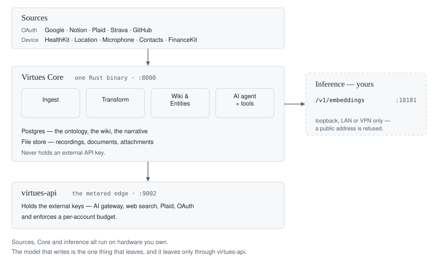

<!--
  ┌─ HEADING CONVENTION (read before editing any # / ## / ### heading) ──────────┐
  Headings are NOT plain markdown text. GitHub's sanitizer strips CSS, so to get
  a serif (Times) heading we render each one as a theme-aware SVG image wrapped in
  a real markdown heading, e.g.:

    ## <picture><source media="(prefers-color-scheme: dark)" srcset=".github/images/headings/h2-foo-dark.svg"></picture>

  Because the heading's visible content is an image (no text), two things follow:
    • The GitHub "Outline" sidebar shows blank labels — accepted tradeoff, which
      is why this file carries a hand-written table of contents under the badges.
    • GitHub can't auto-generate anchors, so each H2/H3 has an explicit
      `<a id="…"></a>` on the line ABOVE it. The TOC links to those ids; some
      headings carry a second, older id so existing deep links keep resolving.

  TO ADD OR EDIT A HEADING (do ALL of these, or you'll get a stale image / dead link):
    1. Edit the heading list in .github/images/headings/gen.py
       (font sizes: H1=34/h40, H2=24/h28, H3=20/h22; weight 400; light+dark each).
    2. Run:  python3 .github/images/headings/gen.py   (regenerates the SVGs).
    3. In this file, update the <picture> block's `alt`, both `srcset`/`src`
       filenames, and the `<a id>` anchor above it. Note gen.py's filename slug
       turns an apostrophe into a hyphen ("Why it's shaped this way" →
       h2-why-it-s-shaped-this-way) while the anchor drops it
       ("why-its-shaped-this-way").
    4. Delete the SVG pair for any heading you removed.

  Keep headings short — wide SVGs (>~360px) get scaled down on mobile, breaking
  the visual size hierarchy. Times is a system font; Linux/Android fall back to
  their default serif.
  └──────────────────────────────────────────────────────────────────────────────┘
-->


# <picture><source media="(prefers-color-scheme: dark)" srcset=".github/images/headings/h1-virtues-dark.svg"></picture>

A self-hosted AI that works from the data of your own life.

[](https://github.com/virtues-os/virtues/actions/workflows/ci.yml)
[](LICENSE)
[](https://discord.gg/sSQKzDWqgv)

[Website](https://virtues.com) · [Docs](https://virtues.com/docs) · [Pre-order the server](https://virtues.com/pre-order) · [Discord](https://discord.gg/sSQKzDWqgv)

Virtues is a server you run at home. It collects data you already produce
(messages, calendar, health, location, transactions, recordings, and files)
and stores it in one Postgres database on your own disk. From that data it
produces three things: a written account of each day, a wiki of the people and
places in your life, and an assistant that answers questions from your data.

Search runs on your own hardware. The only data that leaves the server is what
gets sent to the language model, and it goes through a metered proxy that
doesn't store it. The server opens no inbound ports and has no public
hostname. Your devices connect to it with a cryptographic key.

*Virtues is early software and has rough edges. The
[releases page](https://github.com/virtues-os/virtues/releases) lists what is
available today.*

<a id="diy-quickstart"></a>
## <picture><source media="(prefers-color-scheme: dark)" srcset=".github/images/headings/h2-diy-quickstart-dark.svg"></picture>

There are two ways to run Virtues. You can install the software on your own
Linux machine with one command, which is what this README covers. Or you can
pre-order [the Virtues Server](https://virtues.com/pre-order), which is the
same software on hardware we build. In both cases you can take your data with
you if you stop using it.

Setup takes five steps on a spare Linux machine. A VM works.

**1. Install.** When the installer asks how search should run, keep the
default. It runs search on the server's CPU with the embedding model we
recommend, and keeps that model up to date.

```bash
curl -sSL https://virtues.com/sh | sudo sh
```

**2. Pair a device.** The installer finishes by printing a 6-digit code. Enter
it in the desktop or phone app from
[virtues.com/downloads](https://virtues.com/downloads); a web browser can't
pair. Pairing adds your device's key to the server's allowlist, and that key
is what lets the device reach the server from anywhere. To get a new code:

```bash
sudo virtues pair
```

**3. Connect an account.** The app asks you to connect a Virtues account after
pairing. Search runs locally, but everything that needs the internet goes
through this account:

- the language model that writes your days and answers your questions
- web search
- sign-in for Google, Strava, and other sources
- bank data
- the relay that lets your devices reach the server when you're away from home

If you bring your own model API key, it replaces only the language model. To
do this step from the server instead:

```bash
sudo virtues subscribe
```

**4. Connect a source** in the app: Google, Plaid, Strava, or the phone app
for HealthKit and location. Data starts arriving right away, and the search
index updates as it comes in.

**5. Wait a day.** The server writes each day after it ends, so your first
full day page appears tomorrow. In the meantime, `virtues status` shows which
data is coming in, and `virtues doctor` explains anything that isn't working.

Search on the CPU is fast enough for everyday use. If your machine has a GPU
or NPU, the installer links to [a guide](docs/setup/accelerators.md) for
running search on it. To run your own embedding server, see
[the full install](#the-full-install).

<a id="what-it-does"></a>
## <picture><source media="(prefers-color-scheme: dark)" srcset=".github/images/headings/h2-what-it-does-dark.svg"></picture>

**It writes up each day.** After a day ends, the server builds a timeline from
your data (visits, movement, which devices were nearby, audio, messages,
purchases, and sleep) and then writes a diary entry from that timeline.
Calendar entries don't count on their own. If a meeting is on your calendar
but nothing else shows you were there, the timeline marks it *Unknown*. Each
event also gets a novelty score that compares it with your own history.
[Design notes](agents/build/the-day.md).

**It keeps a wiki of the people and places in your life.** If the same person
appears in your calendar, contacts, and messages, the wiki merges them into
one person with one page.

**It answers questions from your data.** The assistant can run SQL queries on
your tables, search your data by meaning, run Python, search the web, and edit
pages. It works with Claude, GPT, or Gemini. Normal chat has every tool and
asks before any action that changes something. Deep research uses read-only
tools and writes its findings up as a page.

**Where your data goes.** Your data stays on your server, with one exception:
the assistant. When you ask a question, or when the server writes up a day, it
sends the relevant part of your data to a model provider. Audio goes as audio,
not as a transcript. GPS tracks are reduced to distance and pace before
anything is sent. If you point the assistant at a local model, nothing leaves.
The embedding server must run on a local address, and the installer rejects a
public one.

The relay can't read your traffic because it never has the keys. Model
providers can read what they receive, so what happens to it depends on each
provider's data-retention terms.
[The privacy boundary](agents/build/privacy-boundary.md) lists exactly what
leaves the server and what doesn't.

<a id="why-its-shaped-this-way"></a>
## <picture><source media="(prefers-color-scheme: dark)" srcset=".github/images/headings/h2-why-it-s-shaped-this-way-dark.svg"></picture>

**The name.** Each era asks for some virtues that older lists didn't include.
We think owning the data of your own life is one of ours. Companies that
collect data about you can use it to influence you, and if you can't see that
data yourself, you can't tell when it's happening.

**Digital subsidiarity.** Subsidiarity is the principle that a decision should
be made by the smallest group able to handle it. Applied to personal data, it
means your data should live with you, not in a company's datacenter where the
company can read it and may stop caring about it.

Where we could, we designed the system so that we have no way into your
server, so you don't have to rely on our promises:

- Your data is stored on your own disk.
- Search only runs against embedding servers on local addresses.
- Your home network opens no inbound ports.
- The relay forwards encrypted traffic and has no key to decrypt it.
- Our devices are not on your server's allowlist.

**The Rule of Two.** An AI agent becomes dangerous when one run has all three
of these: it reads your private data, it reads text someone else wrote, and it
can send something out. A hostile email can tell the model to mail your
records to a stranger, and with all three the model can do it. Removing any one
of the three breaks that attack. We design the assistant and applets so a run
holds at most two. On Virtues, your messages and email are your data but were
written by other people, so anything that reads your records already has two.
An applet that reads your records gets no way out unless you add one yourself
on its page.

Essays are in [the Library](https://virtues.com/library). Engineering notes
are in [`agents/`](agents/).

<a id="the-ontology"></a>
## <picture><source media="(prefers-color-scheme: dark)" srcset=".github/images/headings/h2-the-ontology-dark.svg"></picture>

The database schema matters more here than in most apps. The assistant reads
it at runtime to write its queries, and the UI builds its tables from it, so
column names need to make sense to both a language model and a person.

All incoming data is stored in one of about two dozen **registered
ontologies**, listed in
[`crates/virtues-registry/src/ontologies.rs`](crates/virtues-registry/src/ontologies.rs).
These are the main ones:

| Family | Tables |
|---|---|
| Health | `data_health_sleep`, `data_health_workout`, `data_health_heart_rate`, `data_health_hrv`, `data_health_steps` |
| Place | `data_location_visit`, `data_location_point`, `data_environment_weather` |
| People | `data_communication_message`, `data_communication_email`, `data_communication_transcription`, `data_calendar_event` |
| Money | `data_financial_transaction`, `data_financial_account` |
| Attention | `data_activity_app_session`, `data_activity_web_browsing`, `data_content_document`, `data_content_bookmark`, `data_content_conversation` |
| Voice | `data_audio_session` |

Each table prefix tells you what kind of data the table holds:

| Prefix | Contents |
|---|---|
| `data_` | Data collected from your sources |
| `wiki_` | The entity graph derived from that data: `wiki_people`, `wiki_places`, `wiki_orgs`, `wiki_events`, `wiki_days` |
| `narrative_` | The structure of your life story: `narrative_telos` → `narrative_acts` → `narrative_chapters` → days |
| `app_` | App state |
| `search_` | Search indexes |
| `elt_` | Pipeline internals |

Column names follow strict rules. We added them after the schema ended up with
**seven** different column names for "when this happened":

- `occurred_at` is when something happened. Use `started_at` / `ended_at` for
something that lasted a while.
- `created_at` / `updated_at` record when the server wrote the row, never when
the event happened. Mixing the two up is how a table once ended up with both
`created_time` and `created_at`.
- Booleans start with `is_` or `has_`, such as `is_active` rather than `active`.
- Every quantity has a unit suffix: `_cents`, `_ms`, `_bytes`, `_meters`.

The assistant's `sql_query` tool reads a description of this schema and runs
read-only queries against it. That is how the assistant answers from your data.
To add a new data type, you add an ontology and a text extractor; the UI and
the search index are generated from the ontology's descriptor.

<a id="architecture"></a>
## <picture><source media="(prefers-color-scheme: dark)" srcset=".github/images/headings/h2-architecture-dark.svg"></picture>

<!-- Replace with a light/dark SVG pair (same machinery as the headings). -->

<picture>
  <source media="(prefers-color-scheme: dark)" srcset=".github/images/architecture/architecture-dark.svg">
  
</picture>

**Core** is a single Rust binary that talks to a single Postgres database. It
handles ingestion, entity resolution, the wiki, pages, chat, and serves the
web UI. It never has access to an external API key.

**Search uses a standard HTTP API.** Core calls an OpenAI-compatible
`/v1/embeddings` endpoint and doesn't care what runs behind it. By default the
installer runs the recommended model on the CPU and keeps it up to date. If you
run your own embedding server instead, the installer tests it and records the
model's fingerprint. If the model is later swapped, Core notices the change
before it can corrupt your index. On the Virtues Server, embedding runs on the
NPU.

**virtues-api** is the proxy that meters model usage. **atlas** manages
accounts and payments: it knows your Stripe customer and an anonymous account
ID, but never sees your usage. Both are in this repo under `services/`. We
don't offer managed hosting. These two services exist so that your server
doesn't need to hold anyone's API keys.

| Source | Streams | Method |
|---|---|---|
| Google | Calendar, Gmail | OAuth |
| Notion | Pages | OAuth |
| Plaid | Transactions, Accounts, Investments, Liabilities | OAuth |
| Strava | Activities | OAuth |
| GitHub | Events | OAuth |
| iOS | HealthKit, Location, Microphone, Contacts, FinanceKit, EventKit | Device |
| macOS | Apps, Browser, iMessage | Device |

<a id="the-full-install"></a>
<a id="install-properly"></a>
<a id="install-linux-home-server"></a>
## <picture><source media="(prefers-color-scheme: dark)" srcset=".github/images/headings/h2-the-full-install-dark.svg"></picture>

<a id="what-to-run-it-on"></a>
<a id="requirements"></a>
### <picture><source media="(prefers-color-scheme: dark)" srcset=".github/images/headings/h3-what-to-run-it-on-dark.svg"></picture>

| Requirement | What, and why |
|---|---|
| **Host OS** | Debian 13+, Ubuntu 24.04 LTS+, or Fedora 40+, `x86_64` or `aarch64`, with systemd and root. A VM is fine; a container is not. |
| **Hardware** | 8 GB RAM and an SSD. **No GPU required.** The language model runs remotely, and the one local model (for search) runs on the CPU. |
| **Storage** | NVMe or SATA SSD. The installer checks the disk type and benchmarks it first. eMMC works up to about 100k items, microSD is slow and wears out, and NFS/SMB can corrupt the database. |
| **Inference** | One `/v1/embeddings` endpoint on loopback, LAN, or VPN. Public addresses are rejected. By default the installer runs one on the CPU. |
| **Network** | Outbound port 443 only. You don't need port forwarding, inbound firewall rules, or a hostname. |

Good choices include a mini PC with 16 GB of RAM and an NVMe slot, a used
small-form-factor desktop, or an aarch64 single-board computer with 8 GB of
RAM and NVMe over PCIe (not microSD).
[What to run it on](docs/setup/requirements.md) explains each requirement.

<a id="inference"></a>
### <picture><source media="(prefers-color-scheme: dark)" srcset=".github/images/headings/h3-inference-dark.svg"></picture>

**This section only applies if you run your own embedding server.** Before it
installs any packages or touches the disk, the installer asks how search
should run. The default runs the recommended embedding model on the CPU. We
don't install GPU or NPU inference software, because we can't test it on
every machine. If you want to use a GPU or NPU, you run the embedding server
yourself and the installer checks that it works.

[llama.cpp](https://github.com/ggml-org/llama.cpp)'s `llama-server` supports
the required API. This is the command our own systemd unit runs:

```bash
# embedder — -ngl 0 keeps it on the CPU (its math overflows fp16 on some GPU paths)
llama-server --embedding --pooling mean -m embeddinggemma-2-Q8_0.gguf \
  --host 127.0.0.1 --port 18181 -c 2048 -b 2048 -ub 2048 -np 1 --cache-ram 0 -ngl 0
```

`-np 1` and `--cache-ram 0` cut the server's memory use from about 2.5 GB to
about 1 GB. These embedding models are known to work (dimensions in
parentheses): **embeddinggemma-2** (768; needs llama.cpp b11507+), gte-small
(384), bge-small-en-v1.5 (384), e5-small-v2 (384), and nomic-embed-text-v1.5
(768).

[Setting up inference](docs/inference.md) covers the details: the exact API,
the rules for prompt prefixes and dimensions, what the fingerprint check
protects against, and how to switch models later without losing data.

<a id="the-command"></a>
<a id="install-in-one-command"></a>
### <picture><source media="(prefers-color-scheme: dark)" srcset=".github/images/headings/h3-the-command-dark.svg"></picture>

```bash
curl -sSL https://virtues.com/sh | sudo sh
```

`virtues.com/sh` installs the newest stable release, and `virtues.com/sh-pre`
installs the newest prerelease. The server remembers which channel you
installed from. [Installing](docs/setup/install.md) explains how to pin a
specific version and how to read the script before running it. The Virtues
Server doesn't need this step; it ships with the software already installed.

The install takes about ten minutes. The installer:

1. asks how to run search and checks any embedding server you point it at
2. benchmarks the disk
3. installs Postgres 18 with pgvector, and Avahi
4. advertises the machine on your local network as `virtues.local`
5. starts `virtues.service`, which generates the Ed25519 key that identifies
   this server
6. prints a **6-digit pairing code**

```bash
sudo virtues pair   # prints a fresh code, any time
```

Enter the code in the desktop or mobile app
([virtues.com/downloads](https://virtues.com/downloads)). **A web browser
can't pair**, because signing in requires an Ed25519 key stored on the device
and a browser tab doesn't have one. The one exception is a browser running on
the server itself, which is trusted at `http://localhost:8000`.

The [releases page](https://github.com/virtues-os/virtues/releases) includes
more than the server. The tag tells you which product a release is for:

| Tag | What it is |
|---|---|
| `vX.Y.Z` | Stable server releases. `virtues.com/sh` and GitHub's *Latest* label point only at these. |
| `vX.Y.Z-staging.N` | Server prereleases, built from the `staging` branch. `virtues upgrade --pre` installs the newest one. |
| `mac-vX.Y.Z` | The Mac app. Its version numbers are separate from the server's and can't be compared with them. |
| `mac-latest` | The newest stable Mac build at a fixed URL, used by the app's updater and the download page. |
| `models-1` | Model and library files that the installer downloads. This isn't a software release. |

<a id="commands"></a>
### <picture><source media="(prefers-color-scheme: dark)" srcset=".github/images/headings/h3-commands-dark.svg"></picture>

| Command | What it does |
|---|---|
| `virtues status` | Shows server health on one screen: identity, inference, subscription, and devices. Add `--json` for machine-readable output to paste into a support thread |
| `virtues doctor` | Checks which embedding server is configured, whether each endpoint responds, and whether the server is reachable. Each problem comes with the command to investigate it |
| `virtues pair` | Prints a code for connecting a device |
| `virtues device ls` / `add` / `rm <id>` | Lists, adds, or removes the devices that can reach this server. A removed device is refused on its next connection attempt |
| `virtues subscribe` | Connects the server to a subscription so the assistant can use a language model |
| `virtues sudo` | Approves a pending sensitive action. Running it proves you have physical access to the server |
| `virtues upgrade` / `rollback` | Moves between releases on this server's channel. The server never updates itself |
| `virtues channel` | Shows or sets the release channel this server follows |
| `virtues backup` / `restore` | Takes and restores snapshots of the server's data |
| `virtues configure-inference` | Re-checks the embedding server after a model change, and offers to re-embed your data |
| `virtues reindex` | Rebuilds the search index from your data |
| `virtues uninstall` | Removes Virtues. It lists everything it found before deleting anything |

Run all of them as `sudo virtues …`. The server runs as its own `virtues`
user, which owns the database, so commands that read or change the database
switch to that user automatically. Commands that change the machine itself
(`upgrade`, `restore`, `uninstall`) keep running as root.

<a id="where-things-live"></a>
### <picture><source media="(prefers-color-scheme: dark)" srcset=".github/images/headings/h3-where-things-live-dark.svg"></picture>

| What | Where |
|---|---|
| Binary | `/usr/local/bin/virtues` |
| Config | `/var/lib/virtues/virtues.env`. After editing, run `sudo systemctl restart virtues` |
| Data | `/var/lib/virtues`, which holds the Postgres cluster and the file store. Set `DATA_DIR` at install to put it somewhere else |
| Models | `/var/lib/virtues/models` |
| Units | `virtues`, plus `virtues-embed` when search runs on the CPU |
| Ports | `8000` server · `5432` Postgres · `18181` embedding |
| Logs | `journalctl -u virtues -f` |

**If something breaks**, start with
[When something breaks](docs/operate/recovery.md).
[agents/build/recovery.md](agents/build/recovery.md) is the longer runbook it
is based on.

**The manual** is in [`docs/`](docs/) and is published at
[virtues.com/docs](https://virtues.com/docs). It covers hardware, inference,
installing, reaching your server, upgrading, backup and restore, and the CLI.

<a id="reaching-your-server"></a>
<a id="reaching-your-box"></a>
<a id="connect-from-another-machine-v02-preview"></a>
## <picture><source media="(prefers-color-scheme: dark)" srcset=".github/images/headings/h2-reaching-your-server-dark.svg"></picture>

**Your server has no public URL.** To connect to it, a device needs a paired
Ed25519 key. Knowing an address isn't enough.

The server is an **iroh endpoint**, identified by its Ed25519 `EndpointId`.
Both sides authenticate with keys, so no certificate authority is involved. A
paired device connects to that ID, and iroh finds a route: directly on your
local network, through NAT hole-punching, or through our relay when neither
works. The server connects out to the relay, so your home network never opens
an inbound port. This works behind CGNAT, on café wifi, and on IPv6-only
ISPs, anywhere outbound port 443 is allowed.

The relay forwards encrypted traffic and has no key to decrypt it. It can see
which two keys are connected and how much data passes between them. That's
why we describe it as end-to-end encrypted, and don't claim it sees nothing
([design notes](agents/archive/networking-relay-tee.md)).

Pairing happens **in person**, with no passwords, email, or magic links. You go
to the machine, run `virtues pair`, and enter the code on the new device, which
adds its key to the allowlist. Access is checked at two layers: iroh rejects
an unpaired key before any HTTP request is processed, and the app then checks
a bearer token on every request. To remove a device, run
`virtues device rm <id>`; its next connection attempt is refused. In daily use
you don't type any of this. The apps store the key and handle the connection,
and on your home network they connect directly on port `8000`.

<a id="build-on-it"></a>
## <picture><source media="(prefers-color-scheme: dark)" srcset=".github/images/headings/h2-build-on-it-dark.svg"></picture>

**Applets** are how you extend Virtues. An applet is a subprocess, written in
any language and described by a `manifest.toml`, that the server starts and
supervises. New data sources and scheduled jobs are both written as applets.
See [`applets/AUTHORING.md`](applets/AUTHORING.md).

**Pages** are collaborative documents (ProseMirror + Yjs) with version history,
AI editing, and `[[entity]]` links to people, places, and other wiki entries.
**Drive** stores files on the server's own disk. Every entity has its own URL,
which is how the web UI supports tabs and split panes.

<a id="development"></a>
## <picture><source media="(prefers-color-scheme: dark)" srcset=".github/images/headings/h2-development-dark.svg"></picture>

This section is for working on the code. To run Virtues for real, use the
install above.

**Prerequisites:** a recent stable Rust toolchain, Node 22+ and pnpm. The dev
loop below is written for macOS on Apple Silicon: `make db` provisions
`postgresql@18` + pgvector through Homebrew, and the embedding sidecar is
llama.cpp's macOS arm64 build. `make dev` needs both.

On Linux, `make db` and `make dev` will not run. Install Postgres 18 with
pgvector yourself, create the role and databases the `db` target in the
Makefile creates, then run `make dev-core` and `make dev-web` in two terminals.
Search stays off unless you run an embedding server of your own.

```bash
git clone https://github.com/virtues-os/virtues
cd virtues
make init   # .env with a fresh encryption key
make dev    # postgres + api :9002 + core :8000 + web :5173 + embed
```

`make dev` runs the whole stack, and Ctrl-C stops it. The first run downloads
the embedding model (about 320 MB) into `.data/`.

```bash
make dev WITH_EMBED=0   # skip the embedding sidecar (search off), for UI work or low RAM
make dev-info           # per-tab commands, for split logs
make dev-link           # a login URL for the local stack
make help               # every target
```

Two things often catch people out. First, there is **no `./target`**
directory: the virtues repos share one cargo target directory, set by an
untracked `.cargo/config.toml`. Second, the crate is named `virtues`, not
`virtues-core`, so run tests with `cargo test -p virtues --lib`.

Several agents work in this checkout at the same time, so some ordinary git
commands can destroy someone else's work here. [`CLAUDE.md`](CLAUDE.md)
explains the branching rules, how to commit safely, and how to claim a
migration number.

<a id="the-repo"></a>
<a id="project-structure"></a>
## <picture><source media="(prefers-color-scheme: dark)" srcset=".github/images/headings/h2-the-repo-dark.svg"></picture>

```
virtues/
├── virtues-core/            # The Rust server (crate `virtues`): API, ingestion, assistant, wiki, day timeline
├── applets/                 # Built-in applets: data sources and jobs that run as subprocesses
├── crates/                  # Shared libraries: iroh transport, reach client, NPU daemon, registry
├── services/                # Cloud services: virtues-api (model proxy), atlas (accounts)
├── apps/                    # Clients: web (also the Tauri iOS/desktop app), desktop helper, Mac collector
├── docs/                    # The user manual, published at virtues.com/docs
├── agents/                  # Internal docs: build guides, records, plans (not published)
├── tools/                   # bootstrap.sh + virtues-installer (virtues.com/sh)
└── masters/, deploy/
```

<a id="security"></a>
## <picture><source media="(prefers-color-scheme: dark)" srcset=".github/images/headings/h2-security-dark.svg"></picture>

Please report vulnerabilities privately through GitHub (**Security** →
*Report a vulnerability*), not in a public issue.
[The reach page](docs/operate/reach.md) explains what the relay can and can't
see, and [the privacy boundary](agents/build/privacy-boundary.md) lists where
data leaves the server.

<a id="license"></a>
## <picture><source media="(prefers-color-scheme: dark)" srcset=".github/images/headings/h2-license-dark.svg"></picture>

- **Most of the repo** is under [BUSL-1.1](LICENSE). The source is available,
and you can self-host it for free for personal or internal organizational use.
You can't use it to offer a hosted service or sell a hardware product. Each
version becomes Apache 2.0 four years after its first public release.
- **The native plugins, the Mac collector, and the data registry** are MIT,
under the `LICENSE` in each directory: [`apps/web/plugins/`](apps/web/plugins/LICENSE),
[`apps/mac-source/`](apps/mac-source/LICENSE) and
[`crates/virtues-registry/`](crates/virtues-registry/LICENSE).

A directory is BUSL-1.1 unless it carries its own `LICENSE`. Vendored
third-party code keeps its upstream license, filed beside it; the models and
libraries a server downloads are listed in
[`THIRD_PARTY_NOTICES.txt`](THIRD_PARTY_NOTICES.txt).